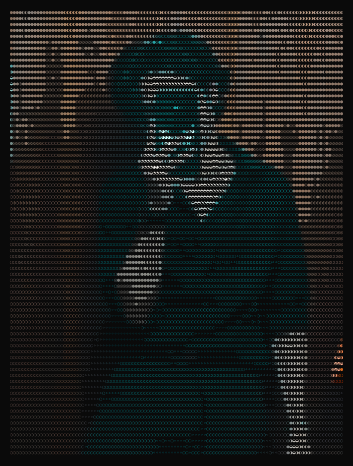

  

<!-- TOP DASHBOARD: ASCII Avatar + Live System Telemetry & 3D Tech Matrix -->
<table>
<tr>
<td align="center" width="45%">
  
</td>
<td align="center" width="55%">
  <code>[ SYSTEM_IDENTITY // LIVE_TELEMETRY ]</code>
    
  <!-- Multi-line Animated Terminal Spec Sheet -->
  
   
  <!-- Live Auto-Updating GitHub Counters (Shields API - Never Breaks) -->
  
  
   
  
  
    
  <code>[ CORE_ARSENAL // STACK ]</code>
    
  <!-- Colorful Modern 3D Skill Icons Grid -->
  
</td>
</tr>
</table>

  

<!-- FEATURED PROJECTS BENTO GRID -->
<code>[ DEPLOYED_SYSTEMS // FEATURED_PROJECTS ]</code>
  

<table>
<tr>
<td width="50%" valign="top">
  <h3 align="center">🧭 LPU Copilot</h3>
  
Smart campus discovery and navigation web guide built for quick campus routing and location search.

  

    
    
  

</td>
<td width="50%" valign="top">
  <h3 align="center">📦 StockSense</h3>
  
Full-stack inventory management application featuring real-time stock tracking and database analytics.

  

    
    
    
  

</td>
</tr>
<tr>
<td width="50%" valign="top">
  <h3 align="center">📊 Student Performance Analyzer</h3>
  
Academic records dashboard connected to MySQL for visualizing and analyzing student metrics.

  

    
    
    
  

</td>
<td width="50%" valign="top">
  <h3 align="center">🚀 Code Alpha — Task 01</h3>
  
Live web project deployed directly from the main branch via automated GitHub Pages workflow.

  

    
    
  

</td>
</tr>
</table>

  

  

<code>[ SYSTEM OVERRIDE // CURRENT STATUS ]</code>
  

 

  

  

<code>[ WEAPONS OF CHOICE ]</code>
  

  

<code>[ SYSTEM_ACTIVITY // COMMIT_SNAKE ]</code>
  
<picture>
  <source media="(prefers-color-scheme: dark)" srcset="https://raw.githubusercontent.com/IshaanChopra02/IshaanChopra02/output/github-snake-dark.svg">
  <source media="(prefers-color-scheme: light)" srcset="https://raw.githubusercontent.com/IshaanChopra02/IshaanChopra02/output/github-snake-dark.svg">
  
</picture>
  

<code>[ SECRET_COMMENTS // DROP_A_MESSAGE ]</code>
  

  

